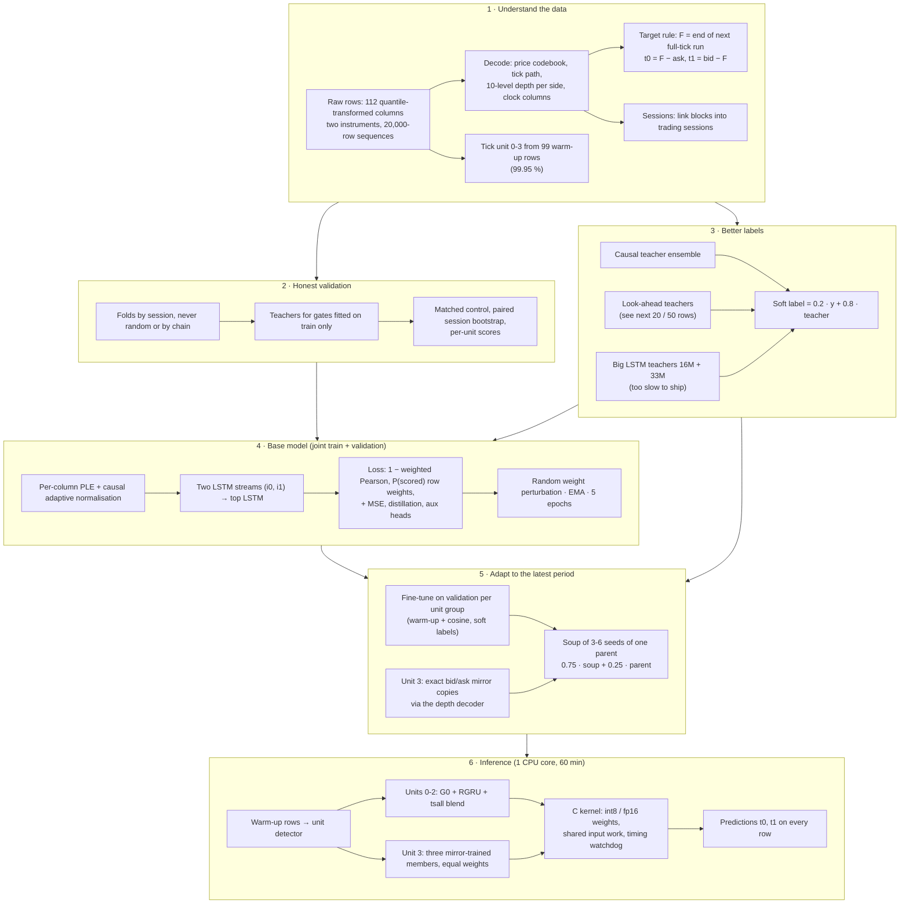

# Wunder Fund Alfa Connectome: our solution

- **Team:** [@ayushcoder894](https://github.com/ayushcoder894), [@jy447](https://github.com/jy447), [@Japjotcpp](https://github.com/Japjotcpp)
- **Result:** public leaderboard 0.66938, public rank 49. Final rank: 58.
- **Competition:** streaming prediction of two price-movement indicators from order books of two instruments, scored by a global weighted Pearson correlation; inference on 1 CPU core in 60 minutes for 39.4 million rows.

This is a write-up, not a code release. Snippets are simplified sketches of the parts we think are unusual; they show the
idea, not our exact implementation.

## Contents

1. [The task in one paragraph](#1-the-task-in-one-paragraph)
   - [Pipeline at a glance](#pipeline-at-a-glance)
2. [What the data turned out to be](#2-what-the-data-turned-out-to-be)
3. [Validation: the part we got wrong first](#3-validation-the-part-we-got-wrong-first)
4. [The base model](#4-the-base-model)
5. [Labels: teachers and look-ahead targets](#5-labels-teachers-and-look-ahead-targets)
6. [Adapting to the validation period](#6-adapting-to-the-validation-period)
7. [Unit 3: the hard market](#7-unit-3-the-hard-market)
8. [The final ensemble](#8-the-final-ensemble)
9. [Fitting it into one CPU core and 60 minutes](#9-fitting-it-into-one-cpu-core-and-60-minutes)
10. [What did not work](#10-what-did-not-work)
11. [After the deadline: why new models kept "fading"](#11-after-the-deadline-why-new-models-kept-fading)
12. [The second pipeline: GRU students and teacher labels](#12-the-second-pipeline-gru-students-and-teacher-labels)
13. [Measuring small gains: the bench audit and transfer](#13-measuring-small-gains-the-bench-audit-and-transfer)
14. [Where the limit is](#14-where-the-limit-is)
15. [Why most attempts failed: seven causes](#15-why-most-attempts-failed-seven-causes)
16. [Final selection and where the score came from](#16-final-selection-and-where-the-score-came-from)
17. [References](#references)

---

## 1. The task in one paragraph

Each sequence is 20,000 consecutive moments of two instruments, `i0` and `i1`: 11 anonymised bid and 11 ask "price-like" and
"volume-like" columns per instrument, 4 trade-price and 4 trade-volume columns per instrument, and 8 additional columns
`a0`-`a7` (112 inputs). The first 99 rows are warm-up. On every later row the model must output two numbers, `t0` and `t1`,
"indicators of the future price movement of i0". Only a hidden subset of rows is scored. The metric is the weighted Pearson
correlation of prediction and target per target (weights = |target|, both clipped to [-2, 2]), pooled over all scored rows of
all sequences, averaged over the two targets. Train: 10,607 sequences; validation: 1,873 with the scored mask; test: 1,970,
streamed row by row to the submission. State must be reset between sequences.

## Pipeline at a glance



## 2. What the data turned out to be

Most of our real progress came from understanding the data, not from model search.

### 2.1 Inputs are quantile-transformed

Every input column is the output of a `QuantileTransformer(output_distribution="normal")`: values are bounded, and a
sentinel `-5.199337 = Φ⁻¹(1e-7)` marks the floor. Price columns are not prices: within a tick unit they jump between a small,
fixed vocabulary of exact vectors shared by all sequences. We built a token table of those vectors (98.5 % coverage on
validation) and decoded an exact tick path for `i0`.

### 2.2 Four markets ("tick units")

Sequences come from four tick sizes (0.1254, 0.2413, 0.4685, 0.6569 in target units). The unit is identifiable from the
first 99 rows at 99.95 % (one error in 1,873) with a small gradient-boosted model on warm-up statistics. The units behave
very differently:

| Unit | Validation sequences | Typical WP | Share of metric weight |
|---|---|---|---|
| 0 | 21 % | 0.80-0.81 | about 0.21-0.28 |
| 1 | 19 % | 0.77-0.78 | about 0.12-0.16 |
| 2 | 23 % | 0.73-0.74 | about 0.08-0.11 |
| 3 (large tick) | 37 % | 0.44-0.45 | about 0.48-0.56 |

Unit 3 carries about half of the metric and is predicted at 0.44. Almost every decision we made was really a unit-3
decision.

### 2.3 The targets have an exact structure

- `t0 = F - ask`, `t1 = bid - F`, with one reference price `F` on the tick grid. Targets sit exactly on the per-unit tick grid.
- Targets change **only** on rows where i0's price columns change (0 exceptions), and `a6` resets **if and only if** a target
  changed (P = 1.000 both ways, all units).
- `F` is the end point of the next full-tick price run (exact on 96 % of unit-3 rows, 82 % of unit 2).
- When `F` lies beyond a quote, the far target is pinned: one target is `+k` ticks and the other exactly `-(s+2)` ticks, with
  `s` the spread code (unit 3: 99.97 %). So `t0 + t1 = -spread` fails exactly in those "beyond" states.
- In unit 3 about 94 % of scored rows are in one "rest" price code, where the book shape does not reveal on which side `F`
  sits. That is the core difficulty of unit 3.

### 2.4 The additional columns are clocks

`a0` is the log of the real time step between rows (Σ exp(3·a0) rebuilds wall-clock time); `a2`/`a3` are EMAs of it;
`a5`, `a6` are wall-clock timers since an event (`a6`: since the last target change; `a5`: since a class of i0 trades); `a7`
is recent event intensity. None of this gave a feature gain by itself (the recurrent model already reads them), but it
explained the data.

### 2.5 The scored mask is not random

Scored rows come in bursts (75 % of gaps between scored rows are 1 row), depend on the target state (in unit 3, spread-2
states are almost never scored, 3-tick states are over-sampled), and are much easier than unscored rows (unit 3: 0.43 vs
0.19 WP for the same model). We trained a small GRU on validation to estimate P(scored | inputs, targets) and used it as a
row weight in training (+0.0005 paired).

### 2.6 Sequences are blocks of whole trading sessions

Sequences are consecutive 20,000-row blocks of longer sessions (1,505 continuation links inside validation, 368 sessions,
only 41 sessions for unit 3). Carrying state from the previous block is worth +0.0002 at most, so we used the links only for
validation (next section).

```python
# Sketch: linking validation blocks into sessions (used only for building honest folds).
# A block's last decoded book state matches the next block's first state exactly.
end_key   = {seq: hash(last_book_state(seq))  for seq in valid_seqs}
start_key = {seq: hash(first_book_state(seq)) for seq in valid_seqs}
by_start  = defaultdict(list)
for s, k in start_key.items():
    by_start[k].append(s)
links = {s: by_start[k][0] for s, k in end_key.items() if len(by_start[k]) == 1}
sessions = connected_components(links)        # each component = one trading session
```

## 3. Validation: the part we got wrong first

Three mistakes cost us weeks; fixing them was worth more than any model change.

1. **Random hold-outs leak.** A random 373-sequence hold-out overstated a validation fine-tune by 4-5x: +0.0027 on the random
   split, +0.0006 on a split that keeps whole chains apart. Our first fine-tuned package (estimated 0.665) scored 0.6585.
2. **Chain folds still leak.** Folds built from the obvious chain map put the same session on both sides for 96 % of unit-3
   sequences. We rebuilt the session map (it found 44 % more links) and moved every gate to **session folds**.
3. **Soft labels can leak through the teacher.** A cross-fitted teacher trained on 80 % of validation still saw most
   held-out sessions; arms that used it looked +0.005 better on unit 3 than they were. Teachers for gates must be train-only.

What held up:

- For joint (train + validation) packages, public ≈ full-validation score − 0.0274, stable within ±0.0015 over a dozen
  submissions. Train-only models transfer about 0.003 worse.
- Paired public deltas between related packages have SD ≈ 0.0006; public vs private for the same model differs with
  SD ≈ 0.009. We stopped reading public deltas under ~0.0015 as signal.
- Gains on unit 3 (half the metric) need two to three seeds: two fine-tunes of one parent that differ only by seed are
  0.0013 apart on unit 3.

```python
# Paired session bootstrap used for every gate (weights |y|, clipped as the metric).
def wp(p, y, w):
    p, y = np.clip(p, -2, 2), np.clip(y, -2, 2)
    mp, my = (w * p).sum() / w.sum(), (w * y).sum() / w.sum()
    return (w * (p - mp) * (y - my)).sum() / np.sqrt((w * (p - mp)**2).sum() * (w * (y - my)**2).sum())

def paired_boot(pa, pb, y, sess, n=300, rng=np.random.default_rng(0)):
    u, ix = np.unique(sess, return_inverse=True); d = []
    for _ in range(n):
        c = np.bincount(rng.integers(0, len(u), len(u)), minlength=len(u))[ix]   # resample whole sessions
        d.append(np.mean([wp(pa[:, k], y[:, k], np.abs(np.clip(y[:, k], -2, 2)) * c)
                          - wp(pb[:, k], y[:, k], np.abs(np.clip(y[:, k], -2, 2)) * c) for k in range(2)]))
    return np.percentile(d, [5, 95]), np.mean(np.array(d) > 0)
```

## 4. The base model

All shipped members are small recurrent networks trained on full 20,000-row sequences with truncated BPTT [1] in 1,000-row
chunks. The ingredients that survived paired tests, in the order we found them (validation gains, one seed unless noted):

| Change | Gain | Note |
|---|---|---|
| LSTM [2] instead of GRU [3] at equal cost | +0.002 | 128 → 192 wide paid only once labels were cleaner |
| Self-supervised auxiliary heads (future decoded price moves at 5-200 rows) | +0.001 | training only |
| Random weight perturbation (N(0, (0.01·|w|)²) on alternate steps) | +0.0005 | SAM [4] and heavier noise did not help |
| Piecewise-linear encoding (PLE) [5] of each input, 8 bins | +0.0008 | factored, zero-initialised |
| Causal adaptive input normalisation (`ain`) | +0.0007 | 672 parameters, proven on 2 seeds |
| LSTM with projection [6] (400 cells → 128) | +0.0007 | |
| Two streams: one per instrument, merged at the top | +0.0004 pooled, **+0.0019 unit 3** | used for unit 3 |

### 4.1 Loss

The loss is the metric itself on each chunk, plus a little MSE for scale:

```python
def wcorr(pred, y, rw):                      # differentiable weighted Pearson
    y = y.clamp(-2, 2); w = y.abs() * rw     # rw = P(scored | x, y) + floor
    W = w.sum()
    yc, pc = y - (w * y).sum() / W, pred - (w * pred).sum() / W
    return (w * yc * pc).sum() / torch.sqrt((w * yc**2).sum() * (w * pc**2).sum() + 1e-12)

loss = sum(1 - wcorr(out[:, k], y[:, k], rw) for k in range(2)) / 2 \
     + 0.1 * (y.clamp(-2, 2).abs() * (out - y.clamp(-2, 2))**2 * rw[:, None]).mean() \
     + distillation_terms + aux_terms
```

### 4.2 Piecewise-linear encoding, factored

PLE (Gorishniy et al., 2022) [5] turns each scalar into a vector of "how far through each quantile bin". With 224 inputs
(values and first differences) × 8 bins the encoding is wide, so we project it to 64 extra LSTM inputs with a zero-initialised
matrix. At export the projection is folded into the LSTM's input weights per code, so inference only adds the rows of
bins that changed.

```python
class PLE(nn.Module):
    def __init__(self, edges, d_out=64):              # edges: [n_cols, n_bins + 1], train quantiles
        super().__init__()
        self.register_buffer("lo", edges[:, :-1]); self.register_buffer("hi", edges[:, 1:])
        self.proj = nn.Linear(edges.shape[0] * (edges.shape[1] - 1), d_out, bias=False)
        nn.init.zeros_(self.proj.weight)              # starts identical to the plain LSTM
    def forward(self, x):                             # x: [B, T, n_cols]
        z = ((x[..., None] - self.lo) / (self.hi - self.lo)).clamp(0, 1)
        return self.proj(z.flatten(-2))
```

### 4.3 Causal adaptive input normalisation

Train and validation differ strongly (a classifier separates them at AUC 0.99). `ain` (related to DAIN [7], but causal) normalises every column by running
statistics of the sequence itself, mixed with the global normalisation by a few learned scalars per column. It is causal (only
past rows) and cheap enough to share between all models at inference.

```python
class CausalAdaptiveNorm(nn.Module):
    """x_t -> mix of (global z-score) and (z-score against this sequence's running mean / var); learned per column."""
    def __init__(self, n, alphas=(1/64, 1/1024)):
        super().__init__()
        self.alphas = alphas
        self.mix = nn.Parameter(torch.zeros(len(alphas), n))   # 0 = plain global normalisation at init
    def forward(self, x, state):                               # state: running means / vars per alpha
        out = x
        for i, a in enumerate(self.alphas):
            m, v = state[i]
            m = (1 - a) * m + a * x; v = (1 - a) * v + a * (x - m) ** 2
            state[i] = (m, v)
            out = out + self.mix[i] * ((x - m) / torch.sqrt(v + 1e-3) - x)
        return out, state
```
(The real version runs the recursion over a chunk with a scan and has one more cross-column term; the idea is the same.)

### 4.4 Two streams

i0 and i1 columns go through separate LSTM stacks; a top LSTM reads both. The partner instrument carries little
information on its own (scrambling i1's prices costs only 0.009), but separating it stopped it from interfering with i0's
representation, and on unit 3 that was worth +0.0019.

## 5. Labels: teachers and look-ahead targets

Raw targets are noisy (a target is constant between price events and then jumps). Distillation [8] gave clean, repeatable gains:

- **Causal teacher ensemble** (`teachmix`, 9 models averaged): the student pulls its main head toward the teacher with the
  same weighted Pearson.
- **Look-ahead teachers** (privileged information used only in training [9]): the same LSTM, but given summaries of the next 20 or 50 rows of the decoded price path. They score
  0.742 / 0.800 on validation (causal models: 0.69). Labels from 20-50 rows of look-ahead helped; 100-500 rows or event-time
  look-ahead hurt (the teacher sees too much the student cannot know).
- **A big teacher:** two wide LSTMs (16M and 33M parameters, 6-14 hours of CPU each, unshippable) averaged as `xlmix`
  (0.6946 validation). Students distilled from it gained +0.0008, and the same labels in the validation fine-tune gave
  +0.0006 on public.
- Soft label for fine-tunes: `0.2 · y + 0.8 · teacher` worked better than either alone.

## 6. Adapting to the validation period

The organisers confirmed that public and private test data lie **after** validation in time, and validation lies after
train. So the validation period is the most test-like data we have.

1. **Joint training.** Every shipped parent is trained on train + validation. Train-only models transferred to public
   about 0.002-0.003 worse than their joint twins.
2. **Validation fine-tunes per unit.** Parents are fine-tuned on validation sequences of one unit group, with warm-up +
   cosine LR [10] (peak 2e-4, 6 epochs), loss weight 0.1 on unscored rows, and soft labels. A constant LR collapsed the models
   (−0.04): they had ended pre-training at ~1e-6.
3. **Weight soups [11].** Three to six fine-tunes of the same parent, differing only by seed, are averaged in weight space,
   then mixed 0.75 / 0.25 with the parent (a WiSE-FT-style hedge [12]). Independent-seed soups failed; same-parent soups work.

```python
def soup(parent, finetunes, alpha=0.75):
    sd = {}
    for k, v in parent.items():
        if v.is_floating_point():
            ft = torch.stack([f[k].double() for f in finetunes]).mean(0)
            sd[k] = (alpha * ft + (1 - alpha) * v.double()).to(v.dtype)
        else:
            sd[k] = v.clone()
    return sd
```

Public effects: units 0-2 fine-tune +0.0010 (J6), with the big-teacher labels +0.0006, the first unit-3 fine-tune +0.0004.

## 7. Unit 3: the hard market

Unit 3 is information-limited: every model family makes the same errors there (residual correlation 0.997), a capacity jump
from 0.8M to 33M parameters adds +0.0003, and hand-built event features, Markov models and boosted trees all stay below the
LSTM. Two things worked.

### 7.1 Bid/ask mirror augmentation, done properly

Mirroring the book (swap bid and ask, negate the direction, swap `t0` and `t1`) doubles unit-3 data. The naive column swap
does not work: the volume columns are a mixed, quantile-transformed encoding, and a model trained on naively swapped rows
predicts direction backwards on real data (AUC 0.398). We decoded the representation first:

- price codes → their mirror codes through the shared codebook;
- volume columns: decoded into 10 price levels per side plus one "latest update" column, by calibrating each column's
  monotone curve so that one-tick moves act linearly, then finding the level-shift maps (an improving move sends level `j`
  to `j+1`);
- trade codes → their partner states.

Rows mirrored through the decoder keep their meaning (a model trained only on mirrored rows reaches AUC 0.862 on real rows
vs 0.863 trained on real rows). Mirrored copies are used in pre-training a unit-3 parent and inside the unit-3 validation
fine-tune.

```python
def mirror_u3(x, y, tables):
    xm = x.copy()
    xm[:, PRICE_I0] = tables.price_mirror[code_of(x[:, PRICE_I0])]      # exact partner code vectors
    bid, ask = decode_depth(x[:, VOL_BID]), decode_depth(x[:, VOL_ASK])  # [T, 11] levels per side
    xm[:, VOL_BID], xm[:, VOL_ASK] = encode_side(ask), encode_side(bid)  # swap sides in decoded space
    xm[:, TRADE_I0] = tables.trade_mirror[trade_code(x[:, TRADE_I0])]
    ym = y[:, ::-1].copy()                                               # t0 <-> t1
    return xm, ym
```

Public: mirror inside the unit-3 fine-tune +0.0002; decoder-based mirror instead of the first version +0.0001; members
from a mirror-pretrained parent at least neutral and more diverse.

### 7.2 Diversity, not size

The unit-3 blend that worked is three members with different parents and different data views at equal weights (a
depth-decoder-mirror fine-tune, a mirror fine-tune of a second seed, and a soup of fine-tunes of a mirror-pretrained
parent). Seed and parent diversity was the only steady unit-3 gain.

## 8. The final ensemble

A small classifier on the 99 warm-up rows picks the unit; each unit gets its own blend:

| Route | Members (weights) |
|---|---|
| Unit 0 | G0 0.45 · RGRU 0.15 · tsall 0.40 |
| Unit 1 | G0 0.40 · RGRU 0.15 · tsall 0.45 |
| Unit 2 | G0 0.20 · RGRU 0.30 · tsall 0.50 |
| Unit 3 | G1d ⅓ · X ⅓ · GM ⅓ |
| Doubtful unit (≈0.2 % of sequences) | G0 only |

- **G0:** joint LSTMP-400 with `ain` and PLE, validation fine-tuned with big-teacher labels, refitted on units 0-2.
- **RGRU:** a second architecture from a separate pipeline: a 2×256 GRU on raw inputs, int8. It was the only partner that
  added a large, nested-validated gain on units 0-2 (+0.0017 validation, +0.0006 public): **pipeline diversity beat
  architecture diversity.**
- **tsall:** a two-stream model fine-tuned on validation.
- **G1d / X / GM:** the unit-3 members of section 7.

About 15 small recurrent models in total, ~19 MB zipped.

## 9. Fitting it into one CPU core and 60 minutes

39.4 million rows in 60 minutes is about 91 µs per row for everything, including Python's per-row callback. Speed decided
how many members we could ship, so inference engineering was a large part of the work.

- **A C kernel** compiled at start-up (gcc, AVX2 / FMA / F16C, a NumPy fallback if compilation fails), with a self-timing guard.
- **Weights in fp16 and int8.** Recurrent matrices in int8 with per-output scales and int16 activations; int8 matched fp16
  scores exactly on our tests. Inference is bound by weight bytes per row, so halving bytes halves time.
- **Incremental input work.** Only ~10 of 224 inputs change per row; the PLE contribution is updated only for changed codes,
  and the adaptive-normalisation core is computed once per row and shared by all models.
- **Packed int8 tiles.** The last speed step (−11 %, bit-identical) packs two int8 weights per 16-bit lane so one
  `vpmaddubsw` serves 32 weights with no sign-extension instructions:

```c
/* low byte = w_a + 128 (unsigned), high byte = w_b (signed); x = int8 activations broadcast as 16-bit pairs */
__m256i p   = _mm256_maddubs_epi16(packed_w, x_pairs);   /* (w_a + 128) * x + ... (unsigned x signed)  */
__m256i s   = _mm256_madd_epi16(p, ones16);              /* widen to int32                            */
/* the +128 offset is removed once per row with a precomputed 128 * sum(x) term; w_b comes from a srai */
```

- **A watchdog.** Per-route µs/row are measured during the run; if the projected total exceeds 59 minutes, the remaining
  sequences switch to a lighter policy. Several early submissions silently fell back to a small model because the start-up
  timing guard was too tight on a noisy host; after that we always kept a 15 % margin and timed packages in Docker with
  one pinned core (the scorer ran about 1.4x slower than Docker).

## 10. What did not work

Each of these was tested against a matched control, most on the full recipe:

- **Architectures:** local attention [13], TCN [14], LRU [15] / diagonal state-space, minGRU / minLSTM [16] stacks, sLSTM [17],
  LayerNorm-LSTM [18], CNNs on the book "image" [19], event-clocked layers, memory cores, multi-head averaging, per-unit specialists. Every one led at
  epoch 0 and faded to a seed or worse by epochs 2-4 (see section 11 for why).
- **Online learning,** in every form we tried: per-sequence recalibration from labels that become known later
  (once a label is causally known it carries nothing), weights carried across sequences (harmful at every learning rate).
- **Features:** order-flow, decoded book levels as inputs, Markov / n-gram event grammars, partner lead-lag, regime
  labels, reconstructed EMA signals. The LSTM already extracts them.
- **Post-processing:** smoothing within target segments (−0.065), per-unit / per-regime rescaling, stackers, gradient-boosted
  trees on hand features (0.38 vs 0.44 on unit 3).
- **Labels:** event-time look-ahead teachers, 100-500-row teachers, bootstrapped TD targets, multi-horizon label averaging.
- **Data:** re-weighting train sequences toward the validation regime (unit-3 train is 64 % "trending" sessions, validation
  96 % "bounce"), adding other units' data to unit 3, time-warp augmentation, target clipping.

## 11. After the deadline: why new models kept "fading"

Looking per unit instead of pooled explained the pattern:

| Big LSTM (16M) by epoch | Unit 0 | Unit 3 | Pooled |
|---|---|---|---|
| 1 | 0.8042 | 0.4375 | 0.6893 |
| 5 | 0.8079 | 0.4455 | 0.6937 |
| 8 | 0.8095 | 0.4262 | 0.6883 |

- More capacity and more training keep helping units 0-2; on unit 3 they turn into memorisation after a point (the same
  model's score on unit-3 **train** sequences rises from 0.515 to 0.606 between epochs 5 and 8 while validation falls).
  Unit 3 is half the pooled metric, so a faster learner reaches the turning point sooner and its pooled lead disappears.
- The old causal teacher helps early in training and becomes a drag late: removing it after the first epoch gave units 0-1
  **+0.0011 / +0.0007**, reproduced on a second seed (+0.0013 / +0.0006).
- Blends restricted to weights in [0, 1] missed that early checkpoints and the old teacher deserve **negative** weights. A
  nested (honest) per-unit committee with free weights reaches 0.6965 against 0.6946 for our best teacher.
- A causal transformer [13] teacher (8 layers, d=512, 2,000-row context) beat the big LSTM at every matched epoch on every unit
  (unit 3 +0.003 at epoch 3), but did not yet add to the teacher blend when we stopped it.

```python
# Free-weight per-unit committee, cross-fitted by session (the honest version nests the source selection too).
def committee(sources, y, unit, fold):
    out = np.zeros_like(y)
    for u in range(4):
        for k in range(2):
            for f in range(5):
                tr, te = (unit == u) & (fold != f), (unit == u) & (fold == f)
                A = np.c_[[s[tr, k] for s in sources].T, np.ones(tr.sum())]
                w = np.abs(np.clip(y[tr, k], -2, 2))
                b = np.linalg.lstsq(A * np.sqrt(w)[:, None], y[tr, k] * np.sqrt(w), rcond=None)[0]   # weights may be < 0
                out[te, k] = np.c_[[s[te, k] for s in sources].T, np.ones(te.sum())] @ b
    return out
```

## 12. The second pipeline: GRU students and teacher labels

Until the packages merged on 11-06, one of us ([@jy447](https://github.com/jy447)) ran a second pipeline: small GRUs [3], a
"fusion" GRU that also reads hand-made streaming features, and teachers that are never shipped. It took the public score
from 0.6479 to 0.6645. Every large step changed the labels, or fitted the model to the scored period:

| Step | Public gain |
|---|---:|
| Fine-tune on the scored rows of the validation sequences | +0.007 |
| Distillation: the student is fitted to the average of causal teachers [8] | +0.003 |
| Two structures in the package (fusion + GRU) | +0.002 |
| A 50-row look-ahead teacher [9] at half the teacher weight | +0.0012 |

- **Loss.** The minimiser of the MSE weighted by `|clip(y)|` is, up to an affine map, the function that maximises the
  weighted correlation. It beat plain MSE by 0.017.
- **Why the validation fine-tune is the largest lever.** It fixes two mismatches at once: the scored rows are a selected,
  easier subset, and validation comes from a later period than train. 70 % of its gain sits in the output layer, but the
  rest needs the recurrent weights: LoRA [20] and LwF [21] style fine-tunes lost 0.0003-0.0022 against a full fine-tune.
- **Cross-fitted labels.** The teacher in the `0.2 · y + 0.8 · teacher` label of sections 5 and 6 is a look-ahead teacher
  fine-tuned on four of five validation folds, labelling the fifth. No sequence is labelled by a model that saw its own
  targets. A label built from the package's own out-of-fold predictions gained +0.0038 on the gate and lost 0.0006 on the
  board.

```python
def wmse(pred, target, y, rows):
    """MSE weighted by the metric's own weights |clip(y)|: its minimiser maximises the weighted Pearson."""
    w = y.clamp(-2, 2).abs() * rows
    return (w * (pred - target.clamp(-2, 2)) ** 2).sum() / w.sum()

# Fine-tune on validation: soft target, scored rows weight 1, unscored rows 0.1 (weights still from the true y).
target = 0.2 * y.clamp(-2, 2) + 0.8 * q.clamp(-2, 2)          # q: the cross-fitted teacher label below
rows = scored.float() + 0.1 * (~scored).float()
loss = wmse(model(x), target, y, rows)

def cross_fitted_labels(teacher_parent, valid_seqs, fold, n_folds=5):
    """q for every validation sequence, from a look-ahead teacher that never saw that sequence's targets."""
    q = {}
    for k in range(n_folds):
        t_k = finetune(teacher_parent, [s for s in valid_seqs if fold[s] != k])   # adapted to the period, blind to fold k
        for s in valid_seqs:
            if fold[s] == k:
                q[s] = predict(t_k, s)                     # reads up to 50 rows ahead of each row
    return q
```

## 13. Measuring small gains: the bench audit and transfer

- **Write the expectation down first.** Before each upload we recorded the expected public change and its SD. Across 44
  such uploads, single changes measured on the deployed models matched the board 12 times out of 12 (mean |error|
  0.0001). Changes that remove or replace a member always came in lower (mean −0.00075): a bench can price the removed
  part only through a weaker stand-in.
- **Never score a package's own members on validation.** A jointly trained member has seen it: X scored +0.027 above its
  train-only twin on validation, and the same on train.
- **Transfer is below 1.** Moving a fine-tune along its task vector [22], `θ = parent + a · (fine-tune − parent)`, gained
  +0.00028 out of fold at `a = 1.3` for the units 0-2 blend. On the board it scored −0.00006. That puts the transfer from
  the validation period to the public period at about 0.87: some 13 % of what a fine-tune learns from validation does not
  carry over, enough to cancel changes of +0.0002.

```python
def dose(parent, finetuned, a):
    """theta = parent + a * (fine-tune - parent). a = 1 is the fine-tune itself; no training."""
    return {k: p + a * (finetuned[k] - p) if p.is_floating_point() else p for k, p in parent.items()}

# Out of fold, relative to the parent: gain(a) = V*a - (N/2)*a^2 with V = 0.0091, N = 0.0071, best a = V/N = 1.28.
# The board keeps a share s of the useful part V; the noise part N stays: gain_board(a) = s*V*a - (N/2)*a^2.
# One upload at a = 1.3 read -0.00006 against a = 1, which fixes s:
V, N = 0.0091, 0.0071
s = (-0.00006 + N / 2 * (1.3 ** 2 - 1)) / (V * 0.3)       # 0.87
best_board_a = s * V / N                                 # 1.12: worth +0.00005 over a = 1
```

## 14. Where the limit is

- **Units 0-2 are saturated.** The members' errors correlate 0.981-0.993, so 97-99 % of each member's error is shared, and
  no existing model adds anything as a fifth member. What still paid was refitting tsall and G0 on the units they serve.
  They had been fine-tuned on all four units, with unit 3 carrying about half of the loss weight. The refit gained +0.00009
  out of fold and +0.0002 on the board.
- **Unit 3 lacks the side, not the size.** On out-of-fold predictions, perfect knowledge of whether the price moves adds
  +0.069; perfect knowledge of the side adds +0.435. The unknown is whether `F` lands beyond a quote (30 % of unit 3's
  scored rows, 65 % of its metric weight). Causal inputs separate it at AUC 0.68, a 50-row look-ahead teacher at 0.71, and
  how far beyond it lands, no model sees.
- **The decoded book is already inside the model.** Level-1 imbalance from the depth decoder correlates 0.39 with the
  realised direction, but 0.82 with the model's own predicted direction. Features built from it add nothing (−0.00006).
- **Mirror training is undecided.** A session-held-out check put mirror fine-tunes at about −0.002 on unit 3. The public
  board leaned the other way in five paired readings (+0.00001 to +0.00025, each inside the noise).

The two checks behind the first two points, as sketches (out-of-fold predictions, the metric's `|y|` weights):

```python
def private_error_share(P, y):
    """P: [rows, members] predictions. Per member, the share of its error variance that the other members do not
    share: the only part averaging can remove. Units 0-2: 0.011-0.016 for the LSTMs, 0.029-0.031 for the GRU."""
    w = np.abs(y) / np.abs(y).sum()
    Pd, yd = P - w @ P, y - w @ y
    E = yd[:, None] - Pd * ((w @ (Pd * yd[:, None])) / (w @ Pd ** 2))   # error after each member's own scale
    C = (E * w[:, None]).T @ E                                         # weighted error covariance
    share = []
    for m in range(P.shape[1]):
        o = [k for k in range(P.shape[1]) if k != m]
        share.append(1 - C[o, m] @ np.linalg.solve(C[np.ix_(o, o)], C[o, m]) / C[m, m])
    return np.array(share)

def oracle_remap(p, y, fold, extra=None, bins=40):
    """Cross-fitted remap: (prediction bin, optional TRUE attribute) -> |y|-weighted mean of y. An oracle attribute
    only locates the missing information. Unit 3: extra = 'F lands beyond a quote' +0.069; extra = 'F above or
    below the mid' +0.435."""
    cell = np.digitize(p, np.quantile(p, np.linspace(0, 1, bins + 1)[1:-1]))
    if extra is not None:
        cell = cell * 2 + extra                             # extra in {0, 1}, read from the true label
    out, w = np.empty_like(p), np.abs(y)
    for k in np.unique(fold):
        tr, te = fold != k, fold == k
        num = np.bincount(cell[tr], w[tr] * y[tr], minlength=cell.max() + 1)
        den = np.bincount(cell[tr], w[tr], minlength=cell.max() + 1)
        out[te] = (num / np.maximum(den, 1e-12))[cell[te]]
    return out
```

## 15. Why most attempts failed: seven causes

Every direction in section 10 that did not move the score falls under one of seven causes:

1. **The missing part is the coming tick change, and the past is already used.** Run backwards in time, a model scores
   0.99; no past quantity correlates with its error above 0.03.
2. **More capacity and longer training fit noise and the training period.** 2 × 512 lost 0.0025 after the fine-tune;
   without an EMA of the weights [23], validation peaks at epoch 3.5-4.
3. **The fine-tune already does it.** Validation data mixed into pre-training: +0.0036 before the fine-tune, −0.001 after.
4. **The period shift cannot be removed from the inputs.** One row tells train from validation at AUC 0.92;
   per-sequence summaries at 0.98.
5. **The model is calibrated, and its per-sequence error does not persist.** Affine slopes are 0.98-1.06; a sequence's
   first half predicts its second half's error at −0.07 to +0.10.
6. **More data, or other data, is not what is missing.** A quarter of the training set scores the same as all of it.
7. **The bench, not the method.** Small-recipe wins vanish in the full recipe, and leaky labels win the gate and lose the
   board.

## 16. Final selection and where the score came from

- **Final selection** (one API call, final): our three best public submissions. 0.669382 (unit 3 at equal weights),
  0.669378 (tsall and G0 refitted on units 0-2), and 0.669244 (a faster int8 build, 2,560 s: the most margin before the
  watchdog if the rescoring hosts are slow).
- **Where the +0.0215 came from** (0.6479 → 0.66938), attributing each board step to what it changed (approximate; the
  steps overlap): fine-tuning on the validation period about 45 %, labels about 33 %, combining models about 20 %, better
  base models about 4 %.

## References

1. R. J. Williams, J. Peng. An efficient gradient-based algorithm for on-line training of recurrent network trajectories. *Neural Computation*, 1990.
2. S. Hochreiter, J. Schmidhuber. Long short-term memory. *Neural Computation*, 1997.
3. K. Cho et al. Learning phrase representations using RNN encoder-decoder for statistical machine translation. *EMNLP*, 2014.
4. P. Foret, A. Kleiner, H. Mobahi, B. Neyshabur. Sharpness-aware minimization for efficiently improving generalization. *ICLR*, 2021.
5. Y. Gorishniy, I. Rubachev, A. Babenko. On embeddings for numerical features in tabular deep learning. *NeurIPS*, 2022.
6. H. Sak, A. Senior, F. Beaufays. Long short-term memory recurrent neural network architectures for large scale acoustic modeling. *Interspeech*, 2014.
7. N. Passalis, A. Tefas, J. Kanniainen, M. Gabbouj, A. Iosifidis. Deep adaptive input normalization for time series forecasting. *IEEE TNNLS*, 2020.
8. G. Hinton, O. Vinyals, J. Dean. Distilling the knowledge in a neural network. arXiv:1503.02531, 2015.
9. D. Lopez-Paz, L. Bottou, B. Schölkopf, V. Vapnik. Unifying distillation and privileged information. *ICLR*, 2016.
10. I. Loshchilov, F. Hutter. SGDR: Stochastic gradient descent with warm restarts. *ICLR*, 2017.
11. M. Wortsman et al. Model soups: averaging weights of multiple fine-tuned models improves accuracy without increasing inference time. *ICML*, 2022.
12. M. Wortsman et al. Robust fine-tuning of zero-shot models. *CVPR*, 2022.
13. A. Vaswani et al. Attention is all you need. *NeurIPS*, 2017.
14. S. Bai, J. Z. Kolter, V. Koltun. An empirical evaluation of generic convolutional and recurrent networks for sequence modeling. arXiv:1803.01271, 2018.
15. A. Orvieto et al. Resurrecting recurrent neural networks for long sequences. *ICML*, 2023.
16. L. Feng, F. Tung, M. O. Ahmed, Y. Bengio, H. Hajimirsadeghi. Were RNNs all we needed? arXiv:2410.01201, 2024.
17. M. Beck et al. xLSTM: Extended long short-term memory. *NeurIPS*, 2024.
18. J. L. Ba, J. R. Kiros, G. E. Hinton. Layer normalization. arXiv:1607.06450, 2016.
19. Z. Zhang, S. Zohren, S. Roberts. DeepLOB: Deep convolutional neural networks for limit order books. *IEEE Transactions on Signal Processing*, 2019.
20. E. J. Hu et al. LoRA: Low-rank adaptation of large language models. *ICLR*, 2022.
21. Z. Li, D. Hoiem. Learning without forgetting. *ECCV*, 2016.
22. G. Ilharco et al. Editing models with task arithmetic. *ICLR*, 2023.
23. B. T. Polyak, A. B. Juditsky. Acceleration of stochastic approximation by averaging. *SIAM Journal on Control and Optimization*, 1992.

---

*Numbers are validation weighted Pearson on all 1,873 sequences unless marked public. Snippets are simplified.*
